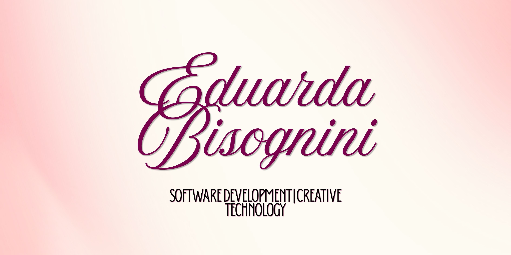

  

# Hi, I'm Eduarda! 👋

### Software Development Student | Aspiring Developer

I'm a student passionate about technology, software development and creative problem-solving.

Currently studying Systems Development and Multimedia, I enjoy combining programming, design and technology to build meaningful digital experiences.

---

## About Me

- 🎓 Studying Systems Development and Multimedia
- 💻 Interested in Web Development and Software Engineering
- 🎨 Combining technology, creativity and design
- 🌱 Continuously learning and developing new skills
- 🚀 Building projects to expand my knowledge and experience

---

## Tech Stack

**Languages & Web Development**

**Tools & Design**

---

## Featured Projects

*Some of my projects and learning experiences.*

### 🐾 HopePet
Animal welfare and responsible adoption project.

### 💻 Web Development Projects
Websites and applications developed as part of my studies and personal projects.

### 🎨 Creative & Multimedia Projects
Digital experiences combining design, creativity and technology.

---

## GitHub Statistics

---

## Let's Connect!

I'm always interested in learning, collaborating and connecting with people in technology.

[LinkedIn](YOUR_LINKEDIN_URL) · [Email](mailto:YOUR_EMAIL)

---

  Building, learning and improving — one project at a time.

